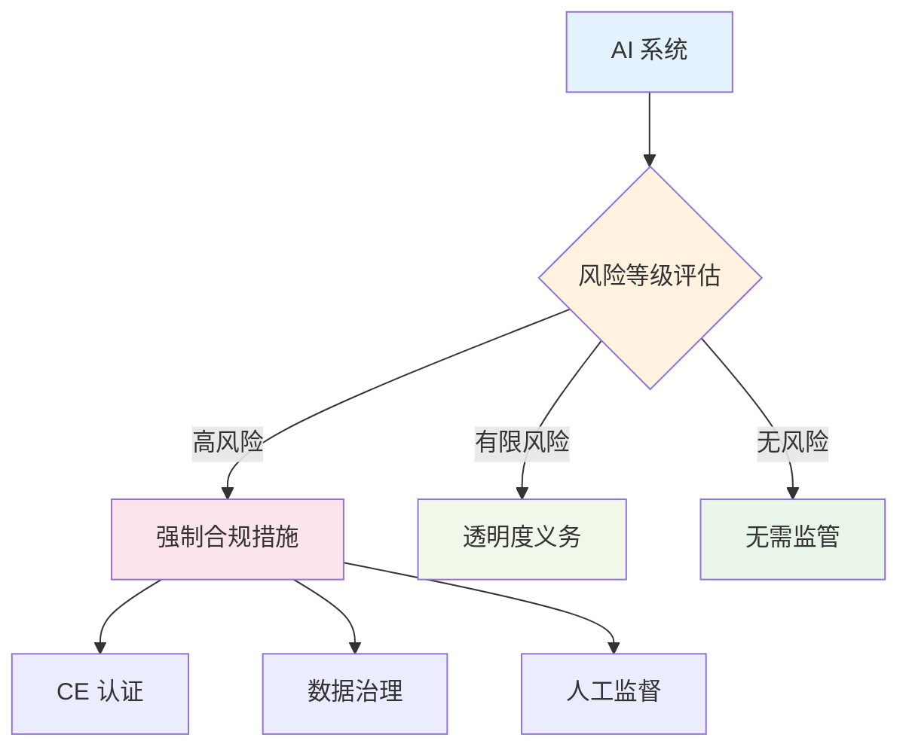
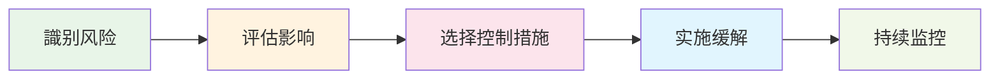
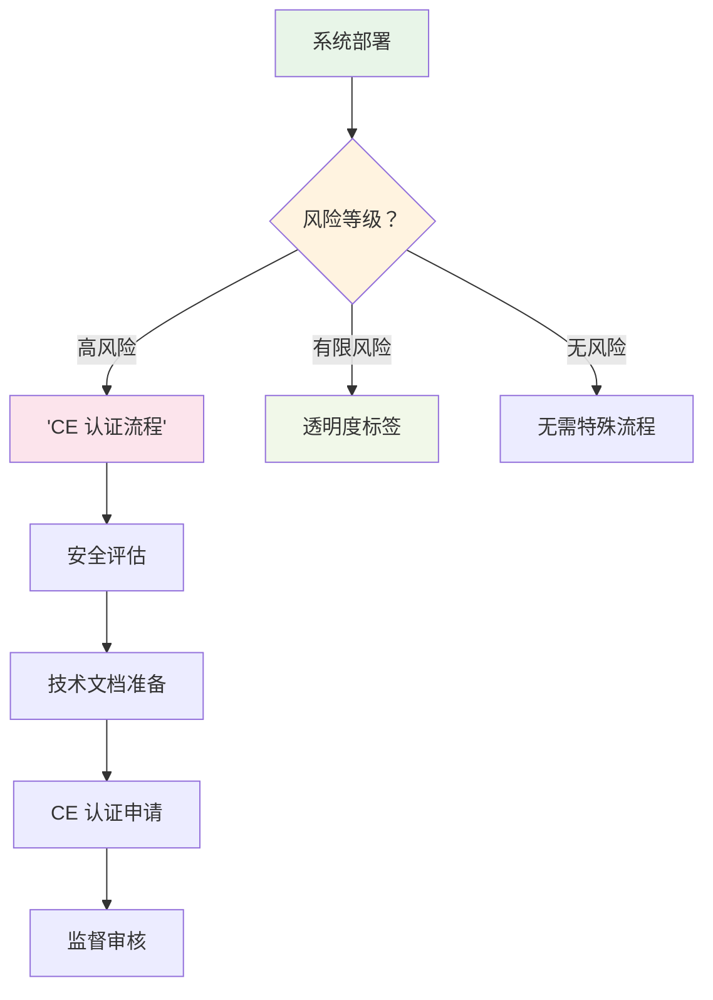

# 2026 AI 治理实操：全球监管框架对比与合规实施指南

> **摘要**：2026 年是 AI 监管落地的关键年。欧盟 AI Act 透明度规则生效，中国 AI 治理框架持续完善，美国软法框架走向定型。本文系统对比三大司法辖区的监管要求，解析风险分类、合规评估、审计认证等实操步骤，为跨国企业提供可落地的 AI 合规指南。

---

## 1. 全球 AI 监管格局：三足鼎立新平衡

### 1.1 欧盟：基于风险的严格合规框架

**核心法规**：
- **《人工智能法案》(AI Act)**：全球首个综合性 AI 监管法律
- **生效时间**：2026 年 8 月全面生效
- **风险分类**：禁止/高风险/有限风险/无风险模型

**关键要求**：


**透明度规则（2026 年 8 月生效）**：
- AI 生成内容必须标识为机器生成
- 深度伪造 (Deepfakes) 需显示可见标签
- 公共利益信息发布必须标注来源

### 1.2 中国：行业导向的精细化治理

**政策框架**：
- **《生成式人工智能服务管理暂行办法》**（2023 年）
- **《的人工智能伦理治理指南》**（2021 年）
- **《算法推荐管理规定》**（2022 年）
- **《互联网信息服务深度合成管理规定》**（2023 年）

**核心原则**：
1. **安全可控**：技术安全 + 内容安全
2. **以人为本**：尊重个人隐私 + 社会影响
3. **创新发展**：鼓励技术创新 + 行业标准

**实施机制**：
- 国家网信办统筹
- 行业标准组织制定技术规范
- 第三方机构开展安全评估

### 1.3 美国：软法框架与行业自律

**监管架构**：
```
联邦机构主导 + 行业标准规范 + 企业自我监管
```

**主要政策文件**：
- **《人工智能权利法案》**（2023 年 10 月）
- **《AI 行动框架》**（NIST AI RMF 1.0）
- **《关于安全、可靠和可信 AI 的行政命令》**（2023 年 10 月）

**特色做法**：
- **NIST AI RMF**：风险管理与框架（自愿采用）
- **行业倡议**：AI Safety Institute，Bletchley Park 宣言
- **州级先行**：加州、科罗拉多州等率先立法

---

## 2. 风险分类与识别：合规的第一道门槛

### 2.1 EU AI Act 风险等级详解

**禁止风险 **(Unacceptable Risk)：
- 社会评分系统（政府/公共机构）
- 生物识别分类系统（警察执法）
- 情感识别系统（教育/工作场所）
- 潜意识操纵技术（违背自由意志）

**高风险 **(High Risk)：
- **关键基础设施**：交通、能源、水务管理
- **教育与培训**：考试评分、招生录取
- **就业管理**：招聘筛选、绩效评估
- **基本服务**：信贷评估、保险精算
- **医疗应用**：诊断辅助、治疗方案建议
- **执法与司法**：犯罪预测、法律文件分析

**有限风险 **(Limited Risk)：
- 情感识别系统（需明确告知）
- 深度生成（Deepfakes）
- chatbots（需声明人机身份）
- AI 生成内容（需标记为机器生成）

### 2.2 中国高风险 AI 系统清单

**重点领域**：
```python
high_risk_ai = {
    "公共服务": ["政务 AI 助手", "智慧城市"],
    "金融科技": ["信贷审批", "反欺诈"],
    "医疗健康": ["辅助诊断", "基因分析"],
    "养老服务": ["照护机器人", "健康监测"],
    "教育评估": ["智能阅卷", "学习分析"],
    "劳动保障": ["招聘筛选", "绩效评估"]
}
```

**评估流程**：
1. **风险识别**：业务场景 + 数据敏感性
2. **影响评估**：个人权益 + 社会安全
3. **安全测试**：算法鲁棒性 + 数据质量
4. **备案审批**：网信办 + 行业主管部门

### 2.3 NIST AI RMF 风险框架

**核心功能**：
- **Govern（治理）**：AI 风险管理政策与监督
- **Map（映射）**：风险识别与优先级排序
- **Measure（衡量）**：风险测量与评估方法
- **Manage（管理）**：风险缓解与持续监控

**实施步骤**：


---

## 3. 合规实施路径：企业级 AI 治理框架

### 3.1 跨国企业 AI 合规架构

**三层治理体系**：
```
┌─────────────────────────────────────┐
│           董事会级监督              │
├─────────────────────────────────────┤
│         风险管理委员会              │
│  ├── AI 治理办公室 │ 合规部 │ 审计部 │
├─────────────────────────────────────┤
│          业务层执行                 │
│ 产品研发 │ 安全测试 │ 数据治理 │ 法务 │
└─────────────────────────────────────┘
```

**职责分工**：
- **董事会**：战略风险承受度审批
- **AI 治理办公室**：标准制定与监督
- **业务部门**：合规流程执行
- **审计合规部**：独立评估与报告

### 3.2 合规实施路线图（2026-2027）

**Phase 1：基础建设（2026 Q1-Q2）**
1. 完成 AI 系统盘点与分类
2. 建立数据治理与风险管理流程
3. 部署合规工具与审计系统

**Phase 2：深度合规（2026 Q3-Q4）**
1. 高风险系统 CE 认证准备
2. 透明度与标签系统实施
3. 第三方风险评估完成

**Phase 3：持续优化（2027 全年）**
1. 合规自动化与实时监控
2. 定期审计与持续改进
3. 行业最佳实践对标

### 3.3 关键文档与流程

**必须文档清单**：
1. **AI 风险评估报告**：详细说明风险等级与弥补措施
2. **数据治理手册**：数据来源、处理、存储规范
3. **算法透明化说明**：模型决策逻辑与可解释性
4. **人工监控方案**：人工监督机制与应急预案
5. **第三方评估报告**：独立机构认证证明

**核心流程**：


---

## 4. 技术实施：从合规要求到系统功能

### 4.1 CE 认证技术准备

**高风险系统技术清单**：
1. **数据质量保障**
   - 数据集偏见检测工具
   - 数据完整性验证机制
   - 数据源追溯系统

2. **算法可解释性**
   - 特征重要性分析
   - 决策路径可视化
   - LIME/SHAP 解释报告

3. **鲁棒性与安全**
   - 对抗攻击测试报告
   - 异常输入识别
   - 错误率与置信度分析

### 4.2 透明度机制实现

**AI 生成内容标识**：
```python
class ContentMarking:
    def mark_ai_generated(self, content, confidence_score):
        if confidence_score > 0.9:
            return {
                'is_ai_generated': True,
                'confidence': confidence_score,
                'watermark': self.generate_watermark(content),
                'label': 'AI 生成内容'
            }
        return {'is_ai_generated': False}
```

**人类身份声明（Chatbot）**：
- 首次交互明确告知
- 持续重合可见提示
- 敏感问题预警机制

### 4.3 人工监督机制

**需要人工监督的场景**：
1. 医疗诊断建议（医生最终确认）
2. 金融信贷决策（人工审核）
3. 司法量刑辅助（法官裁决）
4. 关键基础设施控制（操作员监控）

**监督方案设计**：
- 置信度阈值触发人工介入
- 争议案例自动上报
- 人工反馈系统收集

---

## 5. 行业专项：高风险领域的合规要点

### 5.1 医疗健康 AI 合规

**特殊要求**：
- 临床验证数据（≥ 3 期临床试验）
- 医疗器械注册证（如适用）
- 患者隐私保护协议（HIPAA/GDPR）
- 不良事件报告机制

**评估重点**：
1. 诊断准确性与安全性
2. 与现有诊疗流程的兼容性
3. 医生与患者接受度
4. 法律责任归属界定

### 5.2 金融服务 AI 合规

**监管要求**：
- 反洗钱 (AML) 与了解你的客户 (KYC)
- 反欺诈检测与报告
- 消费者保护与公平信贷
- 数据隐私与信息安全

**合规要点**：
```python
financial_ai_compliance = {
    "审批自动化": {
        "算法可解释性": "必须",
        "人工复核": "高风险案例",
        "偏见检测": "每月一次",
        "审计日志": "留存 5 年"
    },
    "智能投顾": {
        "适合性评估": "必须",
        "风险揭示": "显著标识",
        "人员资质": "投顾执照"
    }
}
```

### 5.3 教育评估 AI 合规

**关键原则**：
- 教育公平性（避免算法歧视）
- 学生隐私保护
- 教师最终决定权
- 评估结果可申诉

**实施指南**：
- 算法偏见定期检测（每学期）
- 师生知情同意与选择权
- 人工审核补课机制
- 第三方评估认证

---

## 6. 审计与持续合规

### 6.1 审计周期与标准

**审计频率要求**：
- **高风险系统**：每年至少一次
- **中风险系统**：每两年至少一次
- **基础系统**：每三年至少一次

**审计清单**：
1. 合规文档更新与完整性
2. 算法性能与偏见检测
3. 数据治理与隐私保护
4. 人工监控与应急机制
5. 第三方评估与认证状态

### 6.2 持续监控指标

**关键绩效指标 (KPIs)**：
```
AI 合规健康度 = 
  (数据质量分 × 0.3) + 
  (算法公平分 × 0.3) + 
  (透明度分 × 0.2) + 
  (安全合规分 × 0.2)
```

**阈值要求**：
- **绿色**：≥ 90 分 (正常运行)
- **黄色**：70-89 分 (需关注改进)
- **红色**：< 70 分 (立即整改)

### 6.3 违规处理与救济

**违规等级与处罚**：

| 违规等级 | 描述 | 处罚措施 |
|----------|------|----------|
| Level 1 | 轻微违规 | 限期整改 + 警告 |
| Level 2 | 一般违规 | 罚款 + 暂停服务 |
| Level 3 | 严重违规 | 吊销许可 + 法律诉讼 |

**救济途径**：
- 行政复议（可向欧盟委员会或网信办申诉）
- 法律诉讼（司法审查）
- 争议解决（调解/仲裁）

---

## 7. 趋势与展望

### 7.1 监管技术发展趋势

**技术赋能监管 (RegTech)**：
1. **自动化合规监控**：AI 驱动的实时合规检测
2. **智能风险评估**：基于大模型的风险预测
3. **区块链审计追踪**：不可篡改的合规记录
4. **隐私计算**：数据可用不可见的安全评估

### 7.2 国际协作与标准互认

**合作机制**：
- **OECD AI 原则**：全球标准制定
- **G20 AI 行动计划**：政策协调
- **APEC 跨境数据流动**：标准互认
- **BSI/ISO 标准**：技术框架统一

**互认进展**：
- EU-USA AI 监管对话机制
- 中国-东盟 AI 合作框架
- 全球 AI 安全伙伴关系

### 7.3 未来挑战与机遇

**待解决难题**：
1. 通用人工智能 (AGI) 监管框架
2. 量子计算时代的加密安全
3. 脑机接口伦理与隐私
4. 自动驾驶法律地位与责任认定

**合规机遇**：
- 合规解决方案市场爆发
- AI 安全认证成为刚需
- 跨国企业合规优势凸显
- 技术驱动的合规服务兴起

---

## 8. 结论与建议

2026 年是全球 AI 监管落地的关键年份。欧盟 AI Act、中国精细化治理、美国软法框架已初具规模。企业需要：

**立即行动**：
1. **AI 系统全面盘点与风险分类**
2. **建立跨国合规框架与治理结构**
3. **部署合规工具与监控系统**

**中长期规划**：
1. **深度融合 SEI(先进性评估指标) 到产品研发流程**
2. **建立持续合规与审计机制**
3. **关注国际监管动态与标准演进**

**核心原则**：合规不是负担而是竞争优势，是技术信任的基石，是企业社会责任的体现。

---

## 参考文献

1. **European Commission**. "Artificial Intelligence Act (Regulation (EU) 2024/XXXX)". https://digital-strategy.ec.europa.eu/en/policies/regulatory-framework-ai

2. **European Commission**. "Rules for Trustworthy Artificial Intelligence in the EU". https://eur-lex.europa.eu/EN/legal-content/summary/rules-for-trustworthy-artificial-intelligence-in-the-eu.html

3. **European Parliament**. "Enforcement of the AI Act" (2024 年). https://www.europarl.europa.eu/cmsdata/305018/Enforcement%20of%20the%20AI%20Act%201.pdf

4. **中共中央、国务院**. "新一代人工智能发展规划" (2017 年 7 月).

5. **国家网信办**. "生成式人工智能服务管理暂行办法" (2023 年 7 月).

6. **OECD**. "Recommendation on Artificial Intelligence" (2019 年、2023 年更新).

7. **NIST**. "AI Risk Management Framework 1.0" (2023 年 1 月).

8. **IEEE**. "IEEE P7001 Complete Algorithm Transparency: Ethical Specifications and Requirements".

9. **欧盟 AI Act Service Desk**. "Frequently Asked Questions". https://ai-act-service-desk.ec.europa.eu/en/faq?page=0

10. **麦肯锡全球研究院**. "The State of AI in 2026" (2026 年 3 月).

---

*本文基于 2026 年全球 AI 监管框架与行业最佳实践编写，所有法律条款与实施指南均有官方来源支持。*
