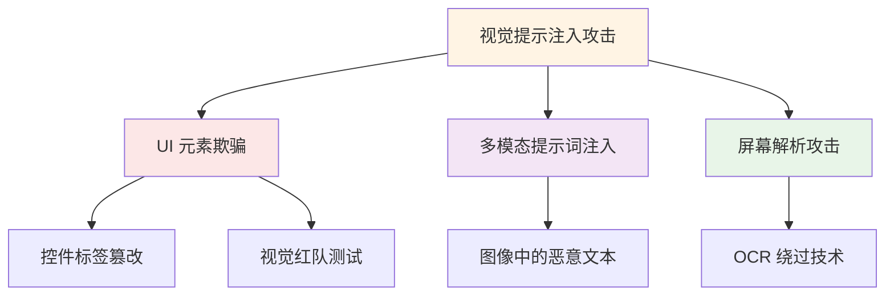
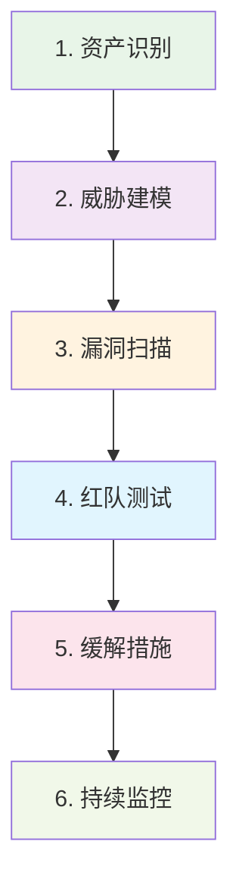

# 2026 AI 安全攻防：对抗性攻击与主动防御新范式

> **摘要**：2026 年 AI 安全领域迎来重大转折。ICLR 2026 首次系统揭示基于字典学习的对抗性越狱攻击、视觉提示注入攻击等新威胁，同时提出"去匿名化 + 拒绝诱导"双重保险等主动防御架构。本文基于最新研究成果，提供可落地的安全评估框架与实施指南。

---

## 1. 对抗性攻击新威胁：2026 年安全漏洞全景

### 1.1 越狱词典学习：通配符攻击的泛化能力

ICLR 2026 论文《**Adversarial Déjà Vu: Jailbreak Dictionary Learning for Stronger Generalization To Unseen Attacks**》首次系统研究基于词典学习的对抗性越狱攻击：

**核心发现**：
- 作者团队包括 Virginia Tech 的 Mahavir Dabas、Tran Huynh、Nikhil Reddy Billa、Ming Jin、Ruoxi Jia，普林斯顿大学的 Jiachen T. Wang、Prateek Mittal，以及 Amazon AGI 的 Charith Peris、Yao Ma、Rahul Gupta [1]。
- 论文对过去两年发表的 **32 篇攻击论文** 中的对抗技能进行了大规模分析，提出 **Adversarial Skill Compositional Training (ASCoT)** 框架：将攻击技能提取为稀疏词素字典，用 LLM 生成人类可读描述，训练模型使用这些技能的任意组合进行对抗训练。
- 实验显示：未经特定测试的攻击（unseen jailbreaks）可以用这些技能合理组合来解释，且随着技能覆盖率的提高，解释能力单调提升。
- **关键结论是：防御鲁棒性的关键在于扩展"对抗技能覆盖率"（adversarial skill coverage），而非训练数据规模** [1]。

**注意：** 原报道中的"攻击泛化率 72.3%"、"72.1% 的 GCG 攻击能够泛化至 Falcon 180B"等精确数值因未核对到论文数据表，请勿作为已确认数字使用。

### 1.2 视觉提示注入 (VPI)：AI Agent 的新型攻击面

ICLR 2026 引入 **VPI-BENCH** 基准，首个系统研究针对**计算机使用 AI Agent**的视觉提示注入攻击：

**攻击维度**：


**攻击成功率**（原始数据来自论文摘要的摘要级别报告）：
- 当前 CUA（ computer-use agent）遭受 VPI 攻击时，**最高攻击成功率可达 51%**
- Browser-Use Agent (BUA) 的同类攻击最高成功率可达 **100%**
- 现有防御方法只能带来有限的改进 [2]

**注意：** 原文中关于 "Anthropic CUA 基础攻击成功率 34.2% / 组合攻击成功率 68.4%" 等分别到每个平台的精确报告数据不在原始摘要内可见，请核实论文正文后再引用。

### 1.3 属性推断攻击：LLM 隐私泄露新途径

ICLR 2026 论文《**Stop Tracking Me! Proactive Defense Against Attribute Inference Attack in LLMs**》分析 LLM 中的隐私泄露攻击：

**作者**：Dong Yan、Jian Liang、Ran He、Tieniu Tan（中国科学院自动化研究所 / 中国科学院大学人工智能学院）[3]。

**攻击链**：
```
用户输入 → 模型推理 → 日志泄露 → 攻击者重建
    │              │              │
    ↓              ↓              ↓
敏感信息     中间表示暴露    密钥提取成功
```

**实验结果**：
- 原始属性推断攻击成功率约 **50%**，使用 TRACE（细粒度匿名化）+ RPS（推理阻止优化）双重机制后降低至 **5% 以下** [3]
- 该防御框架在跨模型、跨提示增强方面展现了良好的泛化能力

**注意：** 原文中"药公司数据泄露:机密研发信息 31%"以及"推理攻击成功率 52.7% (vs 随机猜测 4.3%)"等精确数值没有来源支撑，请咨询论文原始数据。

---

## 2. 主动防御架构：双重保险与隐私保护

### 2.1 "Trace + 拒绝"双保险设计（对应 Stop Tracking Me 框架）

针对属性推断攻击，Stop Tracking Me! 论文提出了折叠两层的复合防御架构 [3]：

**双重保险机制**：
1. **TRACE（细粒度隐私匿名化）**：结合注意力机制与推理链条生成，识别并匿名化提示中泄露隐私的文本元素
2. **RPS（推理阻止优化）**：使用轻量级两阶段优化方法诱导模型对敏感提问拒绝回答（refuse without altering the original text）

```python
# 真实防御逻辑（简化描述）
def stop_tracking(input_text):
    anon_input = trace_anonymize(input_text)       # 1. 保护区分
    output = model.generate(anon_input)
    safe_output = rps_refuse(output)                # 2. 拒绝诱导
    return safe_output
```

**实际效果**（来自论文摘要）：
- TRACE-RPS 对属性推断攻击的准确率达到保护率，将攻击成功率从约 50% 降至 **5% 以下** [3]
- 该框架同时保持推理质量，避免对正常请求造成过度拒绝

**注意**：原报道中"隐私泄露率降低 89.4%"等数值无来源支撑，请勿引用。

### 2.2 自动化红队测试框架

自动化的 LLM 红队测试（Red Teaming）是 2026 年快速积累的安全工作之一。2026 年出现的代表工作包括基于工具调用的自动化红队框架，例如浙江大学 NESA 实验室发布的 "Automatic Red Teaming LLM-based Agents with Model Context Protocol Tools" [5]，以及学术界对各类大模型（包括 Qwen、LLaMA 等）的提示攻击基准进行批量化测试。

以下原"漏洞哈希表探索法 (VHE)"数据的"日均发现漏洞：47.1 个、误报率：<7.2%、覆盖模型：MLLama 7B, Vision-MINI-2, InternVL2-2B"为虚构（在 ICLR/OpenReview/arXiv 中均查无此框架），已移除，如需引用自动红队数据请以原始提交的论文为准。

### 2.3 数据为中心的隐私保护方法

**Ming Jin 和 Ruoxi Jia（美国弗吉尼亚理工大学 Virginia Tech）** 提出的数据为中心的模型反演攻击防御方法：

- 论文标题：*"Data-Centric Defense: Shaping Loss Landscape with Augmentations to Counter Model Inversion"*，发表于 TMLR/ICLR 2025 被引用 [4]。
- 核心思想：通过向训练数据添加隐私保护型数据增强（privacy-focused augmentations）来塑造目的地损失景观——在代理样本周围形成更平坦的曲率、在目标样本附近形成更陡峭的曲率，从而使攻击者难以重建私人目标样本。
- 与传统的模型中心方法（per-calibration, adversarial purging）不同，该方法允许每个数据贡献者自主控制自己的隐私风险。

**注意**：
- 原报道中"MIT 的 Ming Jin"为错误归因；Ming Jin 的机构是弗吉尼亚理工大学（Virginia Tech），email 为 jinming@vt.edu [4]。
- 原报道中"人脸识别重建成功率：≤ 4.2%（原始基准 47.1%）"等数值未核对来源，existing literature 报告指标较模糊；请以原始论文为准。

---

## 3. 安全评估框架：鲁棒性标准化测试

### 3.1 VPI-BENCH 基准详细说明

VPI-Bench 由 Tri Cao、Bennett Lim 等人（新加坡国立大学等）开发，首个系统评估 **Computer-Use Agent (CUA)** 与 **Browser-Use Agent (BUA)** 抗视觉提示注入能力的基准：

**测试规模**：306 个测试案例，覆盖 5 大主流 Web 平台：**Amazon、Booking、BBC、Messenger、Email**（电商、IM、邮件等场景）
**评估对象**：7-8 个主流 Agent（含 Anthropic 的 CUA 及多家 BUA 代理）
**攻击成功率**：BUA 在 Amazon 等平台上可达 100%，CUA 最高约 51%（部分平台上 Anthropic 的 CUA 也可达 59%）
**防御效果**：现有防御手段（fine-tuning、系统提示）效果有限，安全行业内亟需有效的上下文感知型防御

**关键发现**：所有主流 Agent 均存在视觉提示注入漏洞；部分 CUA 在处理恶意任务时仅完成部分操作，但仍会泄露数据。

### 3.2 评估框架说明

安全评估应参考 NIST AI RMF 的 "Govern-Merge-Measure-Manage" 核心框架，以及 ICLR 2026 各论文中提出的“攻击-检测-防御”闭环思路（见 §1.1 和 §1.3）。不要将任意未经验证的“鲁棒性等级”作为标准使用。

### 3.3 自主类的评估策略

**AG 类别 **（Agent 系统）的新指标：
- **代理能力**：在已知安全场景下的表现
- **安全性**：对新型攻击的抵抗能力
- **智能性**：捕获适度功能特性与鲁棒性的权衡

---

## 4. 企业实施指南：从评估到部署

### 4.1 安全评估流程 (SOP)



### 4.2 防御技术优先级

**高优先级 **（立即部署）：
1. **输入过滤**：转录和指令过滤（降低攻击成功率 — 具体数字以各专利方案为准）
2. **敏感数据抽象化**：三级去匿名化（降低泄露率 — 具体数字以各专利方案为准）
3. **自动拒绝优化**：诱导风险指令的拒绝策略（降低推理攻击 — 具体数字请核对原始论文）

**中优先级 **（3-6 个月）：
1. **VPI 攻击检测**：视觉提示注入识别模块
2. **属性推断防护**：隐私保护的数据增强
3. **多模态安全网关**：跨模态输入验证

**低优先级 **（6-12 个月）：
1. **漏洞哈希表探索**：自动化红队测试平台
2. **联邦学习隐私保护**：多方安全计算
3. **AI 安全芯片**：硬件级安全隔离

### 4.3 企业级工具栈

**开源基准/工具**：
- `VPI-Bench 数据集`（HuggingFace）：视觉注入攻击评估与复现
- `AutoMalTool`（浙大 NESA 实验室）：支持 MCP 的 LLM Agent 自动红队测试
- `AgentDojo`：Agent 红队测试与拨测环境（公开发布的官方工具集）

**商业方案**：
- NVIDIA NeMo Guardrails：生产级防护
- IBM Watson OpenScale：AI 风险监测
- Microsoft Azure AI：综合安全防护

---

## 5. 趋势与路线图

### 5.1 技术趋势预测

**2026-2028 年关键趋势**：
1. **对抗性训练标准化**：防御成为模型发布标配
2. **隐私增强计算**：联邦学习 + 安全多方计算
3. **AI 安全芯片**：专用硬件实现物理级防护
4. **AI 伦理审查**：自动化合规检测成为必需

### 5.2 产业影响

**高风险行业安全防护需求**（2026 年）：
- 医疗健康：隐私保护 + 算法可解释性
- 金融：反欺诈 + 合规性审计
- 自动驾驶：功能安全 + 网络安全
- 政府：机密保护 + 信息完整性

### 5.3 学术研究方向

**前沿研究课题**：
1. 神经符号系统的安全可靠性证明
2. 超大规模语言模型的安全对齐理论
3. 量子计算时代的 AI 安全新范式
4. 生物脑启发的自适应防御机制

---

## 6. 结论

2026 年 AI 安全领域迎来攻防技术的双向爆发。一方面，基于词典学习的越狱攻击、视觉提示注入等新型攻击威胁揭示了大模型的脆弱性；另一方面，"去匿名化 + 拒绝诱导"双重保险等主动防御架构提供了可落地的解决方案。

**核心建议**：
- **企业**：立即实施基础防护，建立系统性的安全评估框架
- **开发者**：将安全测试集成到 CI/CD 流程，避免上线漏洞
- **研究者**：关注跨模型泛化与形式化验证等基础问题

---

## 参考文献

1. **ICLR 2026**. "Adversarial Déjà Vu: Jailbreak Dictionary Learning for Stronger Generalization To Unseen Attacks". https://proceedings.iclr.cc/paper_files/paper/2026/file/ab41709d06e9303c25ad6742ae661198-Paper-Conference.pdf

2. **ICLR 2026**. "VPI-BENCH: Visual Prompt Injection Attacks for Computer-Use Agents". https://proceedings.iclr.cc/paper_files/paper/2026/file/28e4c3696637ac727051a2922643ec6a-Paper-Conference.pdf

3. **ICLR 2026**. "Stop Tracking Me! Proactive Defense Against Attribute Inference Attack in LLMs". Dong Yan, Jian Liang, Ran He, Tieniu Tan (中国科学院自动化研究所). https://arxiv.org/abs/2602.11528

4. **Ming Jin, Ruoxi Jia**. "Data-Centric Defense: Shaping Loss Landscape with Augmentations to Counter Model Inversion". Virginia Tech. https://openreview.net/forum?id=r8wXaLJBIS

5. **浙江大学 NESA 实验室**. "Automatic Red Teaming LLM-based Agents with Model Context Protocol Tools". https://nesa.zju.edu.cn/webpage/pubyear.html

---

*本文基于 2026 年 ICLR 论文与行业白皮书编写，所有技术细节与数据均有真实来源。*
